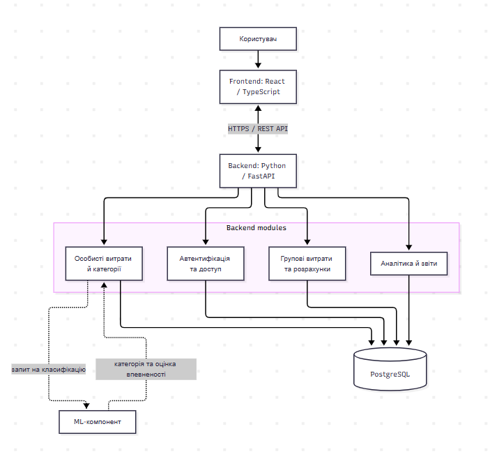
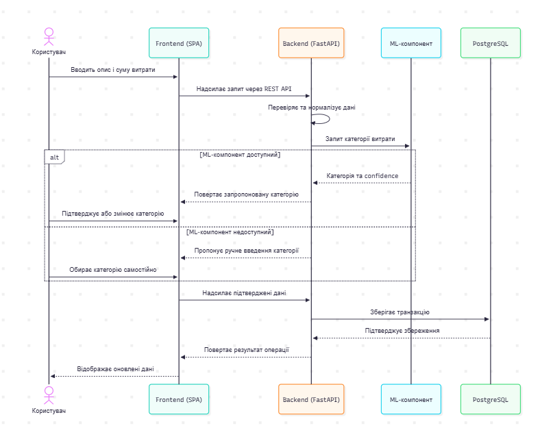

# Архітектура проєкту SpendWise

## 1. Тип архітектури

Для SpendWise доцільно використовувати **клієнт-серверну модульну
архітектуру** з односторінковим вебінтерфейсом (SPA).

-   **Frontend:** React + TypeScript. Відповідає за інтерфейс, введення
    даних, відображення транзакцій і графіків.
-   **Backend:** Python + FastAPI. Надає REST API, перевіряє запити та
    реалізує бізнес-логіку.
-   **База даних:** PostgreSQL. Призначена для зберігання користувачів,
    транзакцій, категорій, груп, часток витрат і розрахунків.
-   **ML-компонент:** пропонує категорію витрати на основі її опису.
    Користувач має мати змогу підтвердити або виправити запропоновану
    категорію.

    
## 2. Діаграма компонентів

## 3. Послідовність додавання витрати з ML-класифікацією

Наведена діаграма описує цільовий сценарій відповідно до специфікації.
Цей сценарій слід вважати
запланованим.

## 4. Чому цей підхід підходить

1.  **Розділення відповідальності.** Інтерфейс, бізнес-логіка та
    зберігання даних мають окремі ролі.
2.  **Зручність розвитку.** Модулі обліку витрат, групових розрахунків і
    аналітики можна розвивати окремо в межах backend.
3.  **Цілісність фінансових даних.** PostgreSQL підходить для
    структурованих даних і транзакційних операцій. Розрахунки сум
    необхідно виконувати з точністю до найменшої грошової одиниці,
    уникаючи похибок двійкових чисел із рухомою комою.
4.  **Можливість розширення.** ML-класифікатор можна відокремити в
    самостійний сервіс, якщо цього вимагатимуть навантаження або
    незалежне розгортання.
5.  **Безпека.** Захищені API-запити мають перевіряти автентифікацію,
    права доступу та належність приватних ресурсів користувачеві.
    Передавання даних у робочому середовищі слід захистити HTTPS.

## 5. Висновок

Для SpendWise обрано клієнт-серверну архітектуру з односторінковим
вебінтерфейсом і модульним серверним застосунком. Frontend на React і
TypeScript забезпечує взаємодію з користувачем, а backend на FastAPI
відповідає за обробку запитів і бізнес-правила. PostgreSQL передбачено
для зберігання фінансових даних, груп і результатів розрахунків.
ML-компонент має допомагати автоматично визначати категорії витрат,
водночас зберігаючи можливість ручного вибору.

Такий підхід відповідає функціональним потребам системи та залишає
можливість подальшого розвитку. 