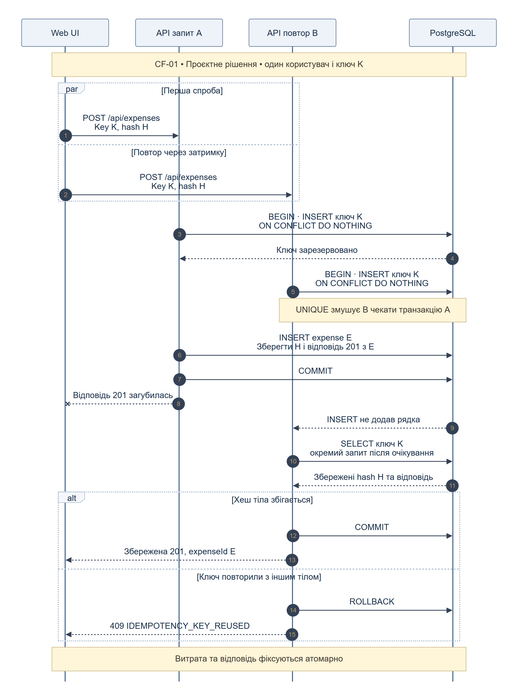
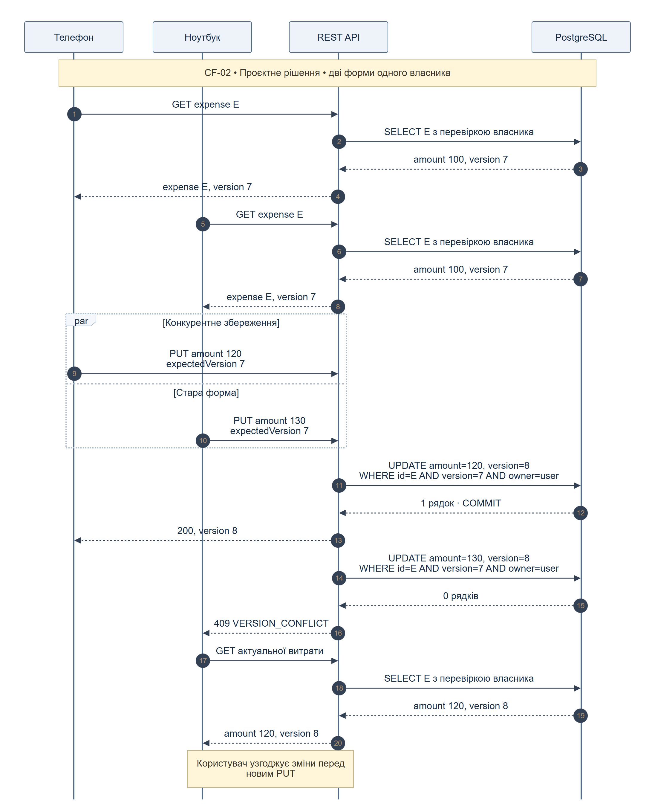
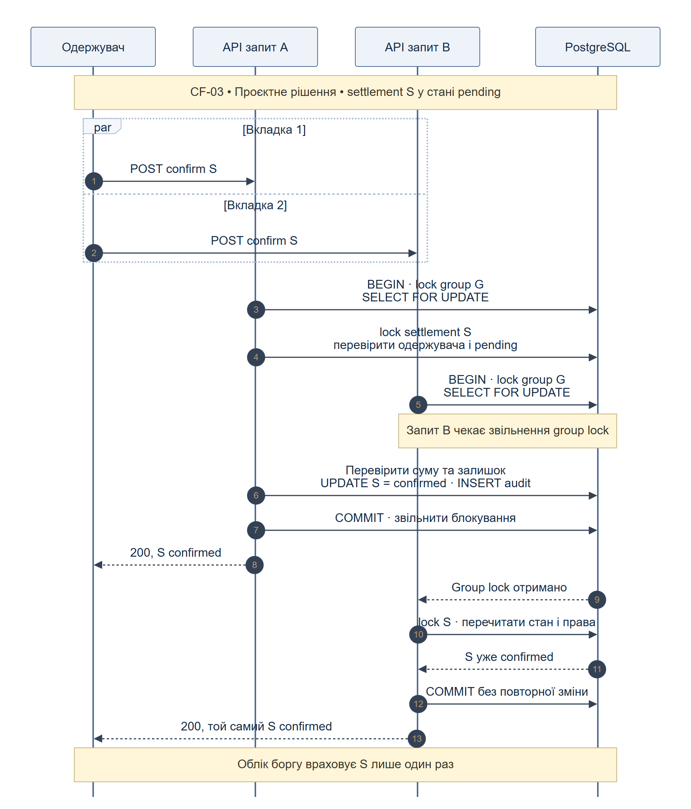
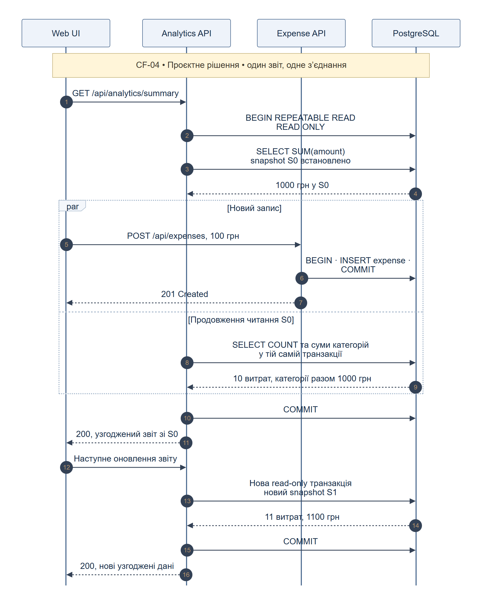
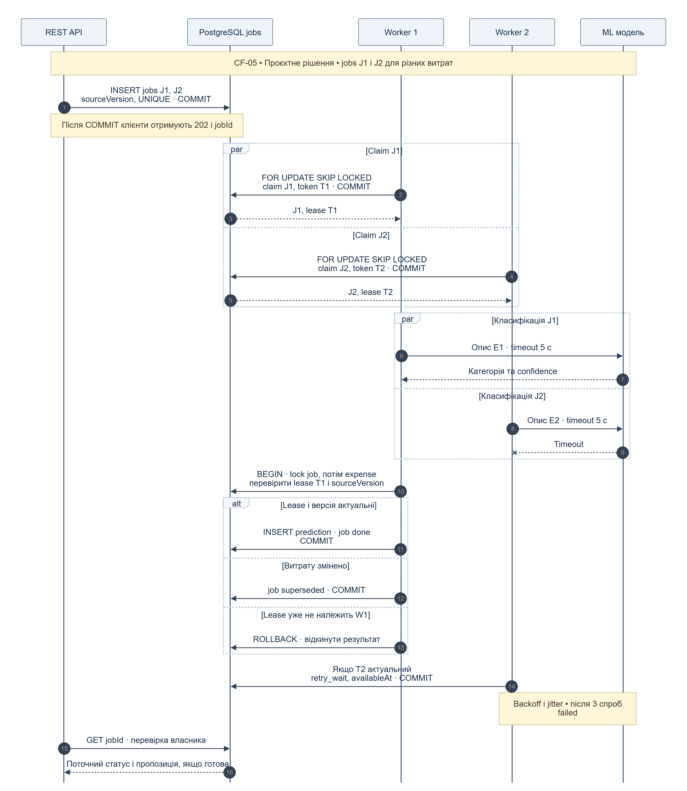

# Патерни конкурентної обробки у SpendWise

Пункт 6 · Concurrency Patterns usage | 22.10.2026

## Зміст завдання

Завдання 6 вимагає обрати щонайменше п’ять сценаріїв, у яких застосовуються concurrency або distributed patterns, побудувати для них sequence-діаграми та пояснити вибір і роботу патернів. Цей звіт містить п’ять таких сценаріїв для SpendWise.

Concurrency означає, що виконання кількох операцій перекривається у часі. Наприклад, два запити можуть прочитати стару суму до того, як один із них її змінить. Parallelism означає фізично одночасне виконання. Для помилки конкурентного доступу достатньо перекриття; кілька процесорів не обов’язкові.

У кожному сценарії визначено спільний ресурс, небезпечний порядок дій, механізм координації, гарантію після завершення та поведінку при збої. Sequence-діаграма читається згори вниз: вертикальні лінії - учасники, стрілки - повідомлення, par - перекриття дій, alt - альтернативи. Сам напис par не захищає дані; це роблять транзакції, обмеження, версії та правила обробки.

## Межі та статус проєктування

Цільова архітектура взята із SRS «Опис Продукту.docx»: React/TypeScript, REST API на FastAPI, PostgreSQL та ML-компонент. Сервіси на діаграмах - логічні модулі або обробники; окремі мікросервіси для кожного модуля не вимагаються. Два API-запити можуть оброблятися різними процесами, тому координація зберігається в спільній БД.

Статус усіх п’яти схем - запропонований дизайн. Наданий main.py є демонстраційною реалізацією Smart Spend Tracker: витрати і категорії зберігаються в Python dict, токен демонстраційний, ML повертає 503, групових маршрутів немає. Цей пакет не змінює код проєкту й не стверджує, що описані патерни вже реалізовані.

У двох матеріалах використано різні назви продукту. Для цього розділу основною є SpendWise з SRS, а існуючі назви маршрутів збережено там, де це можливо. Новий confirm route і GET статусу job явно позначені як розширення контракту.

Наданий openapi.yaml починається з фрагмента схеми та не містить кореневих openapi, info і paths. Він не є повною самостійною OpenAPI-специфікацією. Для прив’язки до існуючих маршрутів використано main.py; DOCX про помилки описує ширший задум контракту. Окремого завершеного документа архітектури з пункту 4 в архіві немає.

## Загальні правила

Усі захищені операції перевіряють користувача, власника ресурсу або членство/роль. Перевірка дозволу не замінює контроль конкурентності, і навпаки.

Гроші зберігаються як Decimal/NUMERIC або цілі мінорні одиниці, не float. Для групи використовується одна базова валюта; сума часток точно дорівнює витраті. У наданому коді amount: float, тому перехід на точне представлення є потрібною зміною.

BEGIN/COMMIT на діаграмі позначає межі транзакції. Помилка до COMMIT означає ROLLBACK. Відповідь про успішний запис надсилається після COMMIT. БД, а не пам’ять окремого worker, є джерелом гарантій.

У схемах пропущено повторювані деталі автентифікації та HTTP-валідації для читабельності. 401/403/404/422 лишаються частиною контракту. Нові коди конфліктів мають використовувати формат application/problem+json з документа пункту 5.

## CF-01 Повторне створення витрати

**Патерн:** Idempotent Request і атомарна транзакція

**Вимоги:** FR-04, NFR-06

**API:** `POST /api/expenses`

**Статус:** Маршрут існує. Idempotency-Key, таблиця ключів і PostgreSQL є запропонованими доповненнями.

### Проблема

Користувач додає витрату на 100 грн. Через затримку мережі клієнт повторює запит, коли перший ще виконується. Два обробники можуть створити дві витрати, хоча користувач здійснив одну покупку.

### Як працює рішення

1. Клієнт генерує один Idempotency-Key для однієї спроби створення покупки та зберігає його для всіх мережевих повторів. Для нової покупки потрібен новий ключ.

2. Після автентифікації сервер обчислює хеш нормалізованого тіла. У PostgreSQL встановлюється UNIQUE(user_id, operation, key), де operation містить метод і маршрут. Текстовий опис сам по собі не є ключем: дві однакові покупки можуть бути правомірними.

3. У короткій транзакції READ COMMITTED сервер резервує ключ через INSERT ... ON CONFLICT DO NOTHING. Паралельний INSERT з тим самим ключем очікує завершення першої транзакції. Запис витрати, ключ, хеш, HTTP-статус і тіло успішної відповіді зберігаються разом.

4. Після конфлікту унікальності другий обробник виконує окремий SELECT. За однакового хешу він повертає збережені 201 і expenseId; за іншого тіла повертає 409 IDEMPOTENCY_KEY_REUSED. Нову витрату в обох випадках не створює.

### Збої та альтернативи

Якщо перша транзакція відкотилась, витрата і ключ відсутні, тож повтор може виконатися. Якщо COMMIT відбувся, а відповідь загубилась, ключ дозволяє повернути результат. Очікування обмежене lock_timeout; після тайм-ауту повертається 503 з Retry-After, клієнт повторює той самий ключ. Запропоноване вікно зберігання ключів - 24 години; після його завершення захист повтору не гарантується.

### Гарантія

У межах вікна зберігання один користувач, одна операція та один ключ породжують не більше однієї витрати.

### Обмеження

Потрібні постійна таблиця ключів та очищення після TTL. Локальний Python Lock або вимкнення кнопки в UI не захищає між кількома процесами API.

Код: [Mermaid](diagrams/mermaid/01_idempotent_expense.mmd). Вектор: [SVG](diagrams/svg/01_idempotent_expense.svg).

Джерела принципів: S1, S2.

## CF-02 Одночасне редагування витрати

**Патерн:** Optimistic Concurrency Control через version

**Вимоги:** FR-05, FR-20, NFR-06

**API:** `GET і PUT /api/expenses/{expenseId}`

**Статус:** Маршрути існують. Поля version, expectedVersion і перевірка конфлікту є доповненнями.

### Проблема

Користувач відкрив одну витрату на телефоні й ноутбуці. Обидві форми прочитали version=7. Телефон змінює суму, а ноутбук надсилає стару форму. Звичайний UPDATE може непомітно перезаписати першу зміну.

### Як працює рішення

1. GET повертає version разом із витратою. PUT обов’язково містить expectedVersion з прочитаної форми. Права власника перевіряються сервером для кожного запиту.

2. Збереження виконується одним умовним UPDATE: WHERE id=:id AND owner_id=:user AND version=:expectedVersion. У тому самому операторі version збільшується на 1. Окремі SELECT version і безумовний UPDATE не дають цього захисту.

3. У показаному порядку перший UPDATE змінює version з 7 на 8. Другий UPDATE з умовою version=7 не змінює жодного рядка. Для наявного й доступного ресурсу API повертає 409 VERSION_CONFLICT.

4. Другий клієнт перечитує поточну витрату та показує користувачу різницю. Після свідомого об’єднання змін він надсилає expectedVersion=8. Автоматично повторювати старе тіло з новою версією не можна.

### Збої та альтернативи

Видалений або недоступний ресурс обробляється за узгодженою політикою 404/403, а відсутня expectedVersion - як 422. Усі шляхи зміни витрати мають дотримуватися версійності. Якщо використати HTTP If-Match замість поля в JSON, невідповідність передумови зазвичай оформлюється як 412; у цій пропозиції свідомо використано expectedVersion та 409.

### Гарантія

Із двох записів, що спираються на ту саму версію, успішний лише один; друга зміна не втрачається мовчки.

### Обмеження

Підходить для рідкісних конфліктів і не тримає блокування, поки користувач редагує форму. За частих конфліктів зростає кількість ручних узгоджень.

Код: [Mermaid](diagrams/mermaid/02_optimistic_edit.mmd). Вектор: [SVG](diagrams/svg/02_optimistic_edit.svg).

Джерела принципів: S3.

## CF-03 Подвійне підтвердження погашення боргу

**Патерн:** Pessimistic Locking і атомарний перехід стану

**Вимоги:** FR-14, FR-16, FR-20, FR-22, NFR-06

**API:** `POST /api/groups/{groupId}/settlements/{settlementId}/confirm`

**Статус:** Новий маршрут на основі FR-16. Групи та settlements у наданому main.py відсутні.

### Проблема

Одержувач підтверджує одне погашення з двох вкладок. Якщо обидва обробники прочитають pending до зміни стану, одна сума може бути врахована двічі. Тут фіксується факт зовнішнього розрахунку між людьми; банківський переказ система не здійснює.

### Як працює рішення

1. Сервер перевіряє автентифікацію, членство та те, що користувач є одержувачем settlement. Після BEGIN він бере SELECT ... FOR UPDATE спочатку на рядок групи, потім на settlement.

2. Усі операції, що змінюють фінансові дані групи, використовують той самий порядок group → settlement/expense. Це серіалізує перевірку суми та стану в межах групи, але дозволяє іншим групам працювати паралельно.

3. Під блокуванням повторно перевіряються права і статус. Для pending перевіряються валюта, додатна сума й допустимий залишок боргу, після чого в одній транзакції записуються confirmed та один запис аудиту. UNIQUE(settlement_id, event_type) захищає подію підтвердження.

4. Другий запит очікує COMMIT першого. Після отримання блокування він бачить confirmed та повертає 200 з тим самим settlement. Повтор не створює нового аудиту і не змінює баланси вдруге.

### Збої та альтернативи

Для скасованого settlement повертається 409 SETTLEMENT_STATE_CONFLICT, для недопустимої суми - 422. При збої до COMMIT зміна стану й аудит відкочуються разом. lock_timeout або вичерпання коротких повторів після deadlock дає 503 з Retry-After. Блокування утримується лише під час транзакції; мережеві виклики під ним не виконуються.

### Гарантія

Settlement переходить pending → confirmed не більше одного разу. Баланс боржника збільшується на a, кредитора зменшується на a; сума балансів групи залишається нульовою.

### Обмеження

Баланси обчислюються з витрат, часток і confirmed settlements, без окремого повторюваного інкременту. Блокування всієї групи спрощує цілісність MVP, але обмежує швидкість записів у дуже активній групі.

Код: [Mermaid](diagrams/mermaid/03_settlement_lock.mmd). Вектор: [SVG](diagrams/svg/03_settlement_lock.svg).

Джерела принципів: S4.

## CF-04 Аналітика під час додавання витрат

**Патерн:** MVCC і Snapshot Isolation через REPEATABLE READ

**Вимоги:** FR-08, FR-17, FR-18, NFR-06

**API:** `GET /api/analytics/summary; запис паралельно через POST /api/expenses`

**Статус:** Маршрути існують. Транзакційний snapshot і врахування групових часток потребують реалізації.

### Проблема

Аналітика читає загальну суму, кількість витрат і категорії кількома SQL-запитами. Між ними інший запит додає витрату. Якщо кожен SELECT бачить свій стан, сума може відповідати 10 витратам, а кількість - вже 11.

### Як працює рішення

1. API відкриває одну транзакцію BEGIN TRANSACTION ISOLATION LEVEL REPEATABLE READ READ ONLY. Перший SELECT встановлює snapshot S0. Усі наступні SELECT цього звіту виконуються на тому самому з’єднанні в тій самій транзакції.

2. Інший обробник одночасно додає витрату й робить COMMIT. Читач продовжує бачити S0 завдяки MVCC. Звичайне читання не бере рядкових блокувань, які зупиняли б цей INSERT.

3. Відповідь містить узгоджені totalAmount, expenseCount і, якщо розширити контракт, byCategory. В усіх запитах застосовуються однакові фільтри користувача, періоду і валюти. Різні валюти не підсумовуються в одне число.

4. Для групової витрати персональна аналітика враховує ExpenseShare цього користувача, а не всю оплату платника. Особисту витрату і її групову частку не можна порахувати двічі. Новий HTTP-запит після завершення попереднього отримує новий snapshot і бачить нову витрату.

### Збої та альтернативи

Звіт може бути вже трохи застарілим у момент відповіді, але залишається внутрішньо узгодженим. Два окремі HTTP-запити до summary і by-category не отримують спільний snapshot автоматично: для узгодженої панелі потрібен один агрегуючий запит. Не слід запускати SELECT на довільних з’єднаннях пулу й вважати їх однією транзакцією.

### Гарантія

У межах однієї валюти сума категорій дорівнює загальній сумі, а кількість та суми обчислені з одного видимого набору витрат.

### Обмеження

Не гарантує найсвіжішого стану на момент доставки відповіді. Потрібні короткі read-only транзакції та statement_timeout: довгі snapshots утримують старі версії рядків і ускладнюють очищення БД.

Код: [Mermaid](diagrams/mermaid/04_snapshot_analytics.mmd). Вектор: [SVG](diagrams/svg/04_snapshot_analytics.svg).

Джерела принципів: S2.

## CF-05 Фонова класифікація кількох витрат

**Патерн:** Producer–Consumer, Competing Consumers і Retry with Backoff

**Вимоги:** FR-06, NFR-01, NFR-05

**API:** `POST /api/expenses/{expenseId}/classify; новий GET /api/classification-jobs/{jobId}`

**Статус:** POST classify існує, але зараз повертає 503. Відповідь 202, jobs, worker і GET статусу є запропонованими доповненнями.

### Проблема

Кілька користувачів одночасно запускають повільну ML-класифікацію. Один синхронний обробник затримує відповіді; необмежений запуск завдань перевантажує модель. Після збою worker та сама робота може виконатися повторно, а пізній прогноз може стосуватися вже зміненого опису.

### Як працює рішення

1. API як producer перевіряє права і в короткій транзакції створює durable job у PostgreSQL. Job містить expenseId, sourceVersion, modelVersion, status, attempts, availableAt, leaseUntil і leaseToken. UNIQUE(expenseId, sourceVersion, modelVersion) дедуплікує той самий прогноз. Після COMMIT API повертає 202 з jobId.

2. Два worker як competing consumers забирають різні готові jobs через SELECT ... FOR UPDATE SKIP LOCKED. В одній короткій транзакції worker встановлює running, новий leaseToken, leaseUntil та збільшує attempts; потім робить COMMIT. ML викликається вже без відкритої транзакції.

3. Наприклад, два workers виконують максимум по одному ML-виклику: сумарно два. Запропоновані параметри для демонстрації: тайм-аут виклику 5 с, lease 30 с, максимум 3 спроби, затримки 1 і 2 с плюс jitter 0–0,5 с. Це конфігурація проєкту, а не виміряні характеристики.

4. У фінальній короткій транзакції worker блокує job, звіряє актуальний leaseToken, строк оренди та стан running. Далі блокує expense і перевіряє sourceVersion. За відповідності він зберігає одну пропозицію категорії та done; за зміни витрати - superseded. Категорія не застосовується без підтвердження користувача.

### Збої та альтернативи

Для тимчасового ML timeout або 503 job переходить у retry_wait з availableAt, після ліміту - failed. Результат старого worker із недійсним leaseToken відхиляється. Після падіння worker прострочену running job може забрати інший worker із новим токеном; це повторне виконання, не гарантія exactly-once. Зміна job і запис прогнозу фіксуються атомарно. GET статусу доступний лише власнику; ручне редагування категорії працює незалежно від ML.

### Гарантія

Один актуальний lease дозволяє фіксацію результату job; пізній прогноз не перезаписує ручну категорію, а повторне виконання не створює дубль результату.

### Обмеження

Для MVP PostgreSQL одночасно є сховищем і durable queue, тому окремий брокер не потрібен. Додаються фонові процеси та eventual consistency для прогнозів. Якщо згодом з’явиться зовнішній брокер, атомарність запису в БД і публікації потребуватиме, наприклад, Transactional Outbox.

Код: [Mermaid](diagrams/mermaid/05_ml_worker_queue.mmd). Вектор: [SVG](diagrams/svg/05_ml_worker_queue.svg).

Джерела принципів: S5, S6.

## Як перевіряти рішення

Критерії приймання наведено у [ACCEPTANCE_TESTS.md](ACCEPTANCE_TESTS.md). Це план перевірки майбутнього коду, а не звіт про виконані тести. Для керування порядком подій потрібні окремі з’єднання та бар’єри синхронізації.

## Що потрібно узгодити з командою

Назву продукту; PostgreSQL і окремі workers в архітектурі; нові поля та маршрути; детальні коди 409; політики TTL, lease, retry і групових блокувань. Поточний main.py цих змін не містить.

## Джерела

- [S1] [AWS EC2 — Ensuring idempotency](https://docs.aws.amazon.com/ec2/latest/devguide/ec2-api-idempotency.html). Принцип повтору з тим самим токеном; застосування до витрат є нашим проєктним рішенням.

- [S2] [PostgreSQL 18 — Transaction Isolation](https://www.postgresql.org/docs/18/transaction-iso.html). READ COMMITTED для CF-01 та REPEATABLE READ для CF-04.

- [S3] [Microsoft Learn — Handling Concurrency Conflicts](https://learn.microsoft.com/en-us/ef/core/saving/concurrency). Умовний UPDATE з concurrency token. EF Core не додається до стеку; використано сам принцип.

- [S4] [PostgreSQL 18 — Explicit Locking](https://www.postgresql.org/docs/18/explicit-locking.html). Рядкові блокування та порядок їх отримання у CF-03.

- [S5] [Microsoft Learn — Competing Consumers](https://learn.microsoft.com/en-us/azure/architecture/patterns/competing-consumers). Розподіл робіт між кількома споживачами.

- [S6] [PostgreSQL 18 — SELECT](https://www.postgresql.org/docs/18/sql-select.html). FOR UPDATE SKIP LOCKED для queue-like таблиці; не для фінансового звіту.

- [S7] [Mermaid — Sequence diagrams](https://mermaid.js.org/syntax/sequenceDiagram.html). Синтаксис учасників, повідомлень, par та alt.

- [S8] [AWS — Transactional Outbox](https://docs.aws.amazon.com/prescriptive-guidance/latest/cloud-design-patterns/transactional-outbox.html). Можливе майбутнє розширення CF-05 при переході на зовнішній брокер.